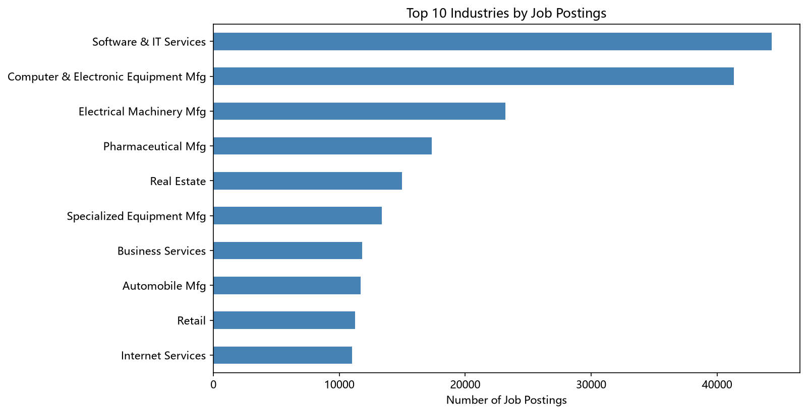
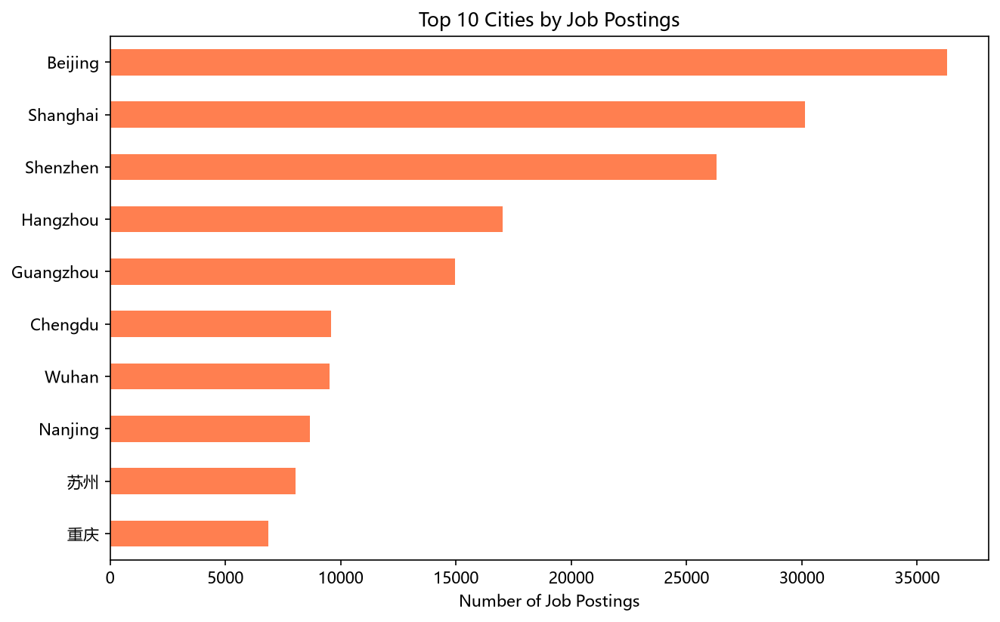
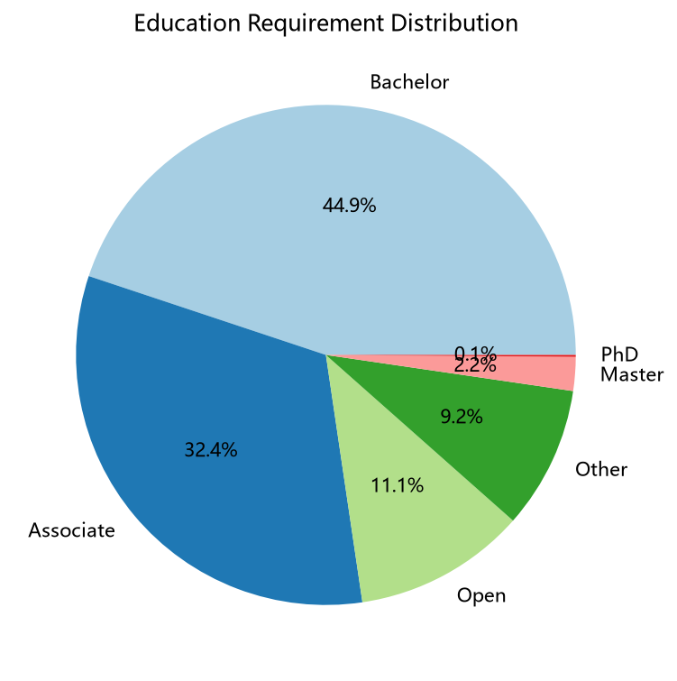
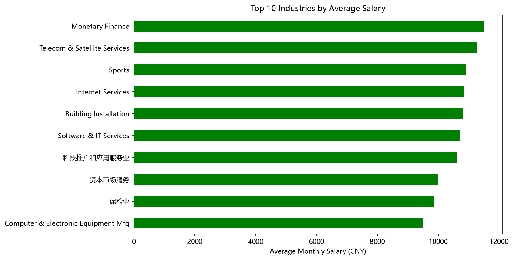
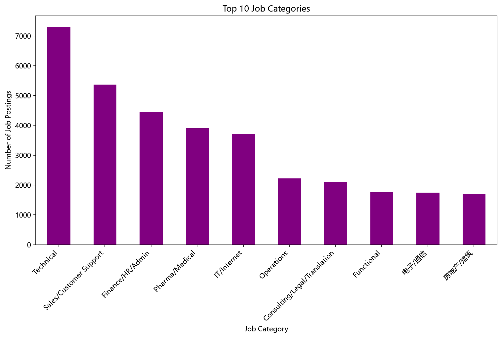
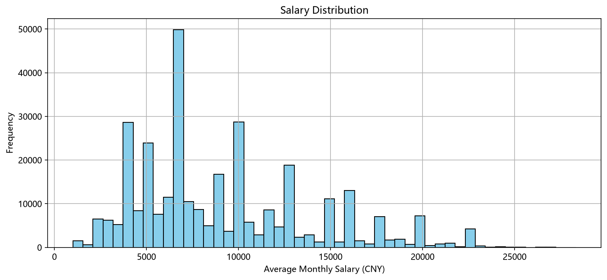

# Listed-Company Recruitment Big Data: Talent Demand Analysis & Employment Trend Study

> **English (primary)** · 中文版见 [`README_中文.md`](README_中文.md)
> An end-to-end portfolio project covering data-governance → analysis → visualization → application, presented in a paper-style, richly illustrated format.

---

## 📄 Abstract

Human-resource big data is a core data asset linking industry, labor, and public employment services. This project takes **listed-company recruitment big data** (2014–2026; **323,818** cleaned records) as its subject. Following data-security and personal-information-protection requirements, it uses **Python** to complete the full ETL cleaning pipeline, **SPSS** and **Matplotlib** for multi-dimensional statistical analysis and visualization, and **Streamlit** to build an interactive dashboard. Findings show: **digital industries lead job postings, talent clusters in first & new first-tier cities, bachelor is the mainstream education requirement, and technical/R&D roles command a salary premium.** Based on these results, differentiated data-application plans are designed for universities, job seekers, enterprises, and HR departments.

**Keywords**: data elements; ETL governance; recruitment big data; talent demand & supply; salary structure; interactive visualization

---

## 1️⃣ Background & Objectives

Listed-company recruitment information reflects industry prosperity, regional economic vitality, and enterprise talent demand. Through data governance and multi-dimensional quantitative analysis, we identify talent-demand characteristics across industries, regions, education levels, and roles, and reveal the evolution of the employment market to support **university cultivation, student career guidance, enterprise allocation, and public governance**.

This project addresses three competition tasks:
1. **Data Cleaning & Governance** — build a high-quality analyzable dataset;
2. **Demand Feature Analysis** — characterize the six dimensions (industry / city / education / job / salary / time);
3. **Hot Jobs & Demand Change** — identify trends over time.

---

## 2️⃣ Data & Methods

### 2.1 Dataset Overview

| Item | Description |
| --- | --- |
| Source | Listed-company recruitment data (2014–2026) |
| Valid samples | **323,818** job records |
| Fields | 10 standardized fields (industry, city, education, job, salary, time) |
| Coverage | 85 industries, 884 cities |
| Governance | Chunked reading + 5% random sampling (`random_state=42`, reproducible) |
| Data file | `data/recruitment_data_cleaned.csv` |

### 2.2 Tech Stack

`Python` (ETL cleaning · pandas/numpy) ＋ `SPSS` (statistical validation) ＋ `Matplotlib/Seaborn` (static charts) ＋ `Streamlit` (interactive dashboard)

### 2.3 Key Code: Salary Outlier Removal (IQR)

```python
# Identify and remove salary outliers using the interquartile range (IQR)
Q1 = df_clean['最高月薪_数值'].quantile(0.25)
Q3 = df_clean['最高月薪_数值'].quantile(0.75)
IQR = Q3 - Q1
lower_bound = Q1 - 1.5 * IQR
upper_bound = Q3 + 1.5 * IQR
df_clean = df_clean[(df_clean['最高月薪_数值'] >= lower_bound) &
                    (df_clean['最高月薪_数值'] <= upper_bound)]
```

### 2.4 Key Code: Education Simplification

```python
def simplify_edu(edu):
    if '博士' in str(edu): return 'PhD'
    if '硕士' in str(edu): return 'Master'
    if '本科' in str(edu): return 'Bachelor'
    if '大专' in str(edu): return 'Associate'
    if '不限' in str(edu): return 'Open'
    return 'Other'
df['学历_简化'] = df['学历要求'].apply(simplify_edu)
```

---

## 3️⃣ Key Findings (Richly Illustrated)

### 3.1 Industry: Software & Electronics Lead

Software & IT services and computer/electronic equipment manufacturing lead by a wide margin — the digital economy and high-end manufacturing form the main force of talent demand.



### 3.2 Region: First-tier City Siphon Effect

Beijing, Shanghai, Shenzhen, Hangzhou, and Guangzhou form the first tier of talent demand, far ahead of others.



### 3.3 Education: Bachelor & Associate Dominate

Bachelor and Associate together account for ~**77%**, the absolute majority of hiring; postgraduate demand concentrates in high-precision R&D roles.



### 3.4 Salary: Overall Average & High-Paying Industries

Overall average monthly salary ≈ **9,104 CNY**; knowledge-intensive & modern-service industries (finance, telecom, internet) lead.



### 3.5 Job Category: Technical & General Roles Coexist

Technical roles rank first; combined with IT/Internet categories, digital roles further rise, confirming a widening tech-talent gap under digital transformation.





---

## 4️⃣ Interactive Visualization System

An **Streamlit** dashboard supports real-time filtering by industry and city, showing KPI cards, six charts, and a data preview.

```python
# Sidebar filter + KPI card (excerpt from dashboard.py)
industries = ['All'] + sorted(df['上市公司行业'].dropna().unique().tolist())
selected_industry = st.sidebar.selectbox("Select industry", industries)
col1.metric("📊 Total Job Posts", f"{len(filtered_df):,}")
```

Run: `streamlit run code/dashboard.py`

---

## 5️⃣ Trend Analysis

- **Industry structure drives demand**: digital economy (software, internet, IT) and high-end manufacturing (electronics, electrical, pharma) keep expanding.
- **Talent agglomerates in high-tier cities**: first & new first-tier cities show a clear siphon effect.
- **Large applied-talent gap**: bachelor/associate-dominant structure shows enterprises value practical, hands-on talent.
- **Role structure upgrading**: technical/digital roles lead, demanding rising composite skills.

---

## 6️⃣ Applications & Recommendations

- **For universities**: strengthen digital-economy majors and add applied-skill courses.
- **For students**: prioritize digital roles and build hard skills (programming, data analysis).
- **For enterprises**: expand technical hiring and improve salary incentives; watch growth industries like pharma and electronics.
- **For government / industrial parks**: introduce talent-attraction policies for high-demand industries to ease structural imbalances.

---

## 7️⃣ Conclusion

Through multi-dimensional analysis of 323,818 listed-company job records, this project systematically characterizes talent-demand structure: **digital economy & high-end manufacturing lead demand, first-tier cities concentrate talent, bachelor/associate dominate hiring, and technical roles have the largest gap.** The process and visualization output are fully open-sourced, reproducible, and traceable.

---

## 📁 Repository Structure

```
recruitment-data-analysis/
├── README.md / README_中文.md    # EN/CN portfolio (this file)
├── 数据分析报告.md / _中文       # Analysis report
├── 数据清洗说明文档.md / _中文    # Data-cleaning documentation
├── requirements.txt
├── data/recruitment_data_cleaned.csv
├── code/ data_cleaning.py · dashboard.py · generate_charts.py
├── images/ zh/ (CN) · en/ (EN)
└── docs/task_description.pdf
```

## ▶️ How to Run

```bash
pip install -r requirements.txt
python code/data_cleaning.py        # data cleaning & analysis
python code/generate_charts.py      # generate CN/EN charts
streamlit run code/dashboard.py     # interactive dashboard
```

## ✍️ Author

**Chen Conghui (陈聪惠)** · Guangzhou Business School · Big Data Management & Application · Data Analysis / Visualization · Portfolio Project #1

---
*Project completed independently based on a competition task. Code and data processing fully open-sourced.*
