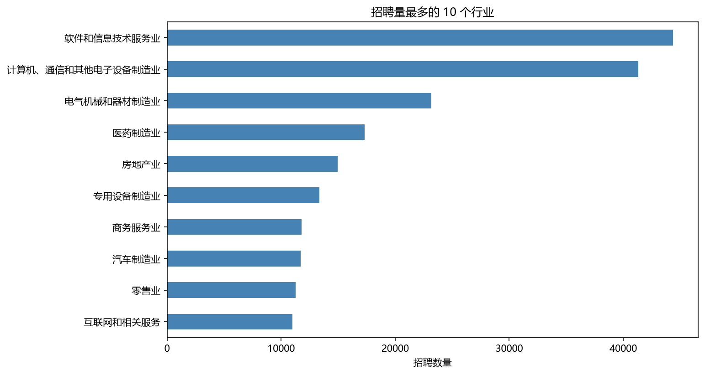
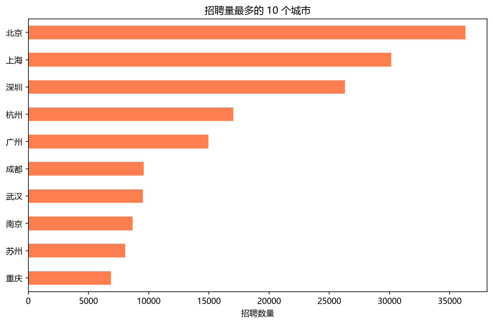
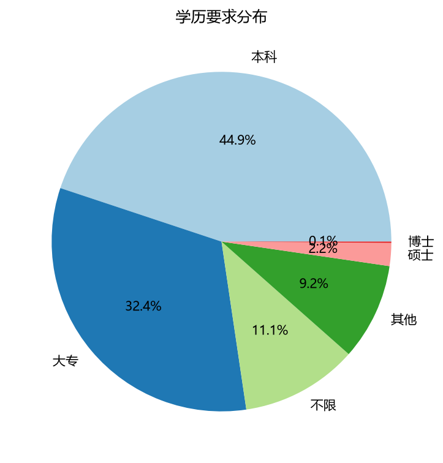
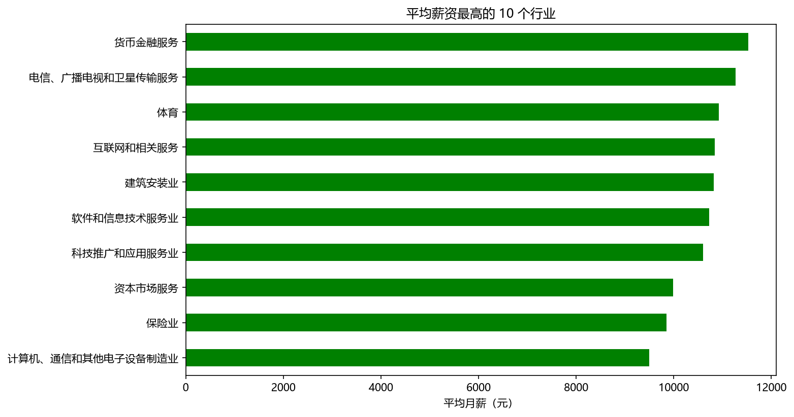
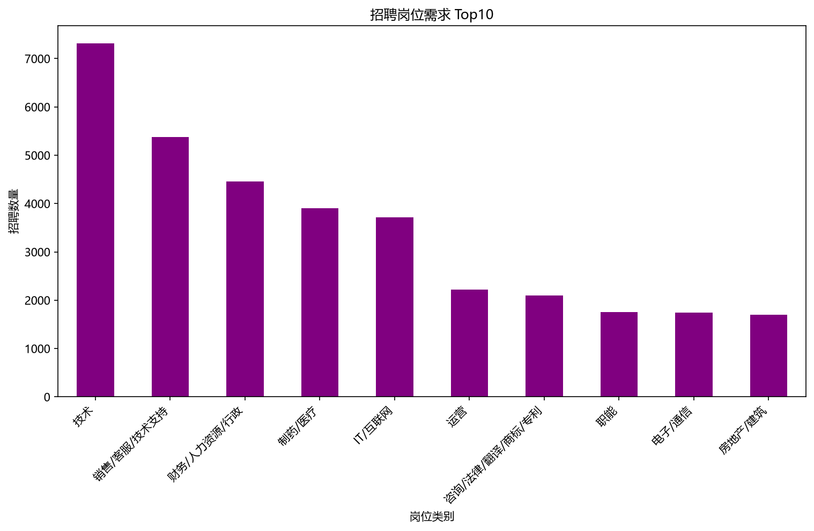
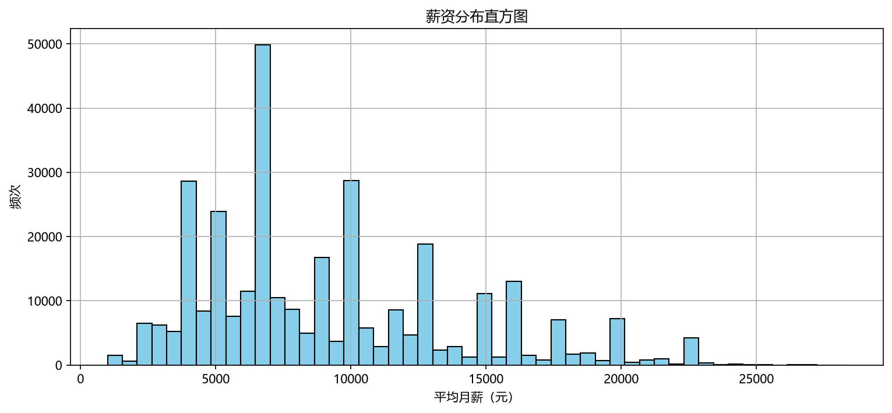

# 上市公司招聘大数据：人才需求变化分析与就业趋势研判

> **中文版** · English version: [`README.md`](README.md)
> 一份数据要素「治理 → 分析 → 可视化 → 应用」全链路作品集，论文式图文并茂展示。

---

## 📄 摘要

人力资源大数据是衔接产业、劳动力与公共就业服务的核心数据资产。本项目以**上市公司招聘大数据**（2014—2026 年，清洗后 **323,818 条**有效记录）为研究对象，遵循数据安全与个人信息保护要求，运用 **Python** 完成 ETL 全流程数据清洗标准化，借助 **SPSS** 与 **Matplotlib** 开展多维度统计分析作图，并基于 **Streamlit** 搭建交互式可视化看板。实证显示：**数字产业招聘量领先、一线及新一线城市集聚人才、本科为主流学历门槛、技术研发类岗位薪酬优势突出**。依据结论，面向高校、求职者、企业与人社部门设计差异化数据应用方案，探索招聘数据要素的市场化开发模式。

**关键词**：数据要素；ETL 治理；招聘大数据；人才供需；薪酬结构；交互式可视化

---

## 1️⃣ 研究背景与目标

上市公司招聘信息反映产业景气度、区域经济活力与企业人才需求结构。通过数据治理与多维量化分析，可识别不同行业、地区、学历、岗位的人才需求特征，揭示就业市场演化规律，为**高校培养、学生择业、企业配置、公共治理**提供数据支撑。

本项目对应赛题三项任务：
1. **数据整理与治理**——构建可分析的高质量数据集；
2. **招聘需求特征分析**——刻画行业 / 城市 / 学历 / 岗位 / 薪资 / 时间六维结构；
3. **热点岗位与人才需求变化研究**——结合时间维度研判趋势。

---

## 2️⃣ 数据与方法

### 2.1 数据集概况

| 项目 | 说明 |
| --- | --- |
| 数据来源 | 上市公司招聘大数据（2014—2026） |
| 有效样本 | **323,818 条**招聘记录 |
| 字段 | 行业、城市、学历、岗位、薪资、时间等 10 个标准化字段 |
| 覆盖 | 85 个行业、884 个城市 |
| 治理方式 | 分块读取 + 5% 随机采样（`random_state=42` 可复现） |
| 数据文件 | `data/recruitment_data_cleaned.csv` |

### 2.2 技术栈

`Python`（ETL 清洗 · pandas/numpy）＋ `SPSS`（统计分析验证）＋ `Matplotlib/Seaborn`（静态作图）＋ `Streamlit`（交互看板）

### 2.3 关键代码：薪资异常值剔除（IQR 方法）

```python
# 基于最高月薪的四分位距(IQR)识别并剔除薪资异常
Q1 = df_clean['最高月薪_数值'].quantile(0.25)
Q3 = df_clean['最高月薪_数值'].quantile(0.75)
IQR = Q3 - Q1
lower_bound = Q1 - 1.5 * IQR
upper_bound = Q3 + 1.5 * IQR
df_clean = df_clean[(df_clean['最高月薪_数值'] >= lower_bound) &
                    (df_clean['最高月薪_数值'] <= upper_bound)]
```

### 2.4 关键代码：学历层级简化

```python
def simplify_edu(edu):
    if '博士' in str(edu): return '博士'
    if '硕士' in str(edu): return '硕士'
    if '本科' in str(edu): return '本科'
    if '大专' in str(edu): return '大专'
    if '不限' in str(edu): return '不限'
    return '其他'
df['学历_简化'] = df['学历要求'].apply(simplify_edu)
```

---

## 3️⃣ 关键发现（图文并茂）

### 3.1 行业维度：软件与电子制造主导

软件和信息技术服务业、计算机通信电子制造业招聘量断层领先，数字经济与高端制造构成人才需求主力。



### 3.2 地区维度：一线城市虹吸效应显著

北京、上海、深圳、杭州、广州构成人才需求第一梯队，就业资源高度集中。



### 3.3 学历维度：本科与大专为主力

本科与大专合计占比约 **77%**，是上市公司用人的绝对主体；硕博集中于高精尖研发岗位。



### 3.4 薪资维度：整体均薪与高薪行业

全样本平均月薪约 **9,104 元**；金融、电信、互联网等知识密集型与现代服务业薪资领先。



### 3.5 岗位维度：技术型与通用型并存

技术类岗位需求居首，叠加 IT/互联网类目后数字化岗位占比进一步抬升，印证数字化转型下技术人才缺口扩大。





---

## 4️⃣ 交互式可视化系统

基于 **Streamlit** 搭建看板，支持按行业、城市实时筛选，展示指标卡、六大图表与数据预览。

```python
# 侧边栏筛选 + 指标卡（dashboard.py 关键片段）
industries = ['All'] + sorted(df['上市公司行业'].dropna().unique().tolist())
selected_industry = st.sidebar.selectbox("Select industry", industries)
col1.metric("📊 Total Job Posts", f"{len(filtered_df):,}")
```

运行方式：`streamlit run code/dashboard.py`

---

## 5️⃣ 趋势研判

- **产业结构驱动需求**：数字经济（软件、互联网、IT）与高端制造（电子、电气、医药）持续扩张。
- **人才向高能级城市集聚**：一线及新一线城市虹吸效应明显，就业市场呈空间极化。
- **应用型人才缺口大**：本科 / 大专为主流学历，企业对「能上手、能落地」的应用型人才需求旺盛。
- **岗位结构升级**：技术 / 数字化岗位需求领先，复合技能要求持续提升。

---

## 6️⃣ 应用价值与建议

- **面向高校**：加强软件、电子信息、数据分析等专业建设，增设应用型技能课程。
- **面向学生**：优先布局数字化岗位，强化编程与数据分析硬技能。
- **面向企业**：加大校招与技术岗投入，完善薪资激励，关注医药、电子成长型行业。
- **面向政府/园区**：针对高需求行业出台人才引进与培育政策，缓解结构性供需矛盾。

---

## 7️⃣ 结论

通过 323,818 条上市公司招聘记录的多维量化分析，系统刻画了人才需求结构：**数字经济与高端制造主导需求、一线城市集聚人才、本科大专为用人主力、技术岗位缺口最大**。研究过程与可视化成果完整开源，可复现、可追溯。

---

## 📁 目录结构

```
recruitment-data-analysis/
├── README.md / README_中文.md    # 中英文作品集（本文件）
├── 数据分析报告.md / _中文       # 分析报告
├── 数据清洗说明文档.md / _中文    # 数据治理说明
├── requirements.txt
├── data/recruitment_data_cleaned.csv
├── code/ data_cleaning.py · dashboard.py · generate_charts.py
├── images/ zh/（中文图）· en/（英文图）
└── docs/task_description.pdf
```

## ▶️ 如何运行

```bash
pip install -r requirements.txt
python code/data_cleaning.py        # 数据清洗与分析
python code/generate_charts.py      # 生成中英文图表
streamlit run code/dashboard.py     # 交互看板
```

## ✍️ 作者

**陈聪惠** · 广州商学院 大数据管理与应用专业 · 数据分析 / 数据可视化方向 · 作品集项目 #1

---
*基于赛事赛题独立完成，代码与数据处理完整开源。*
